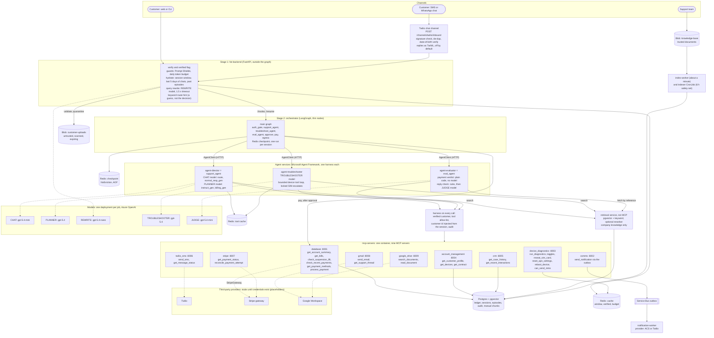
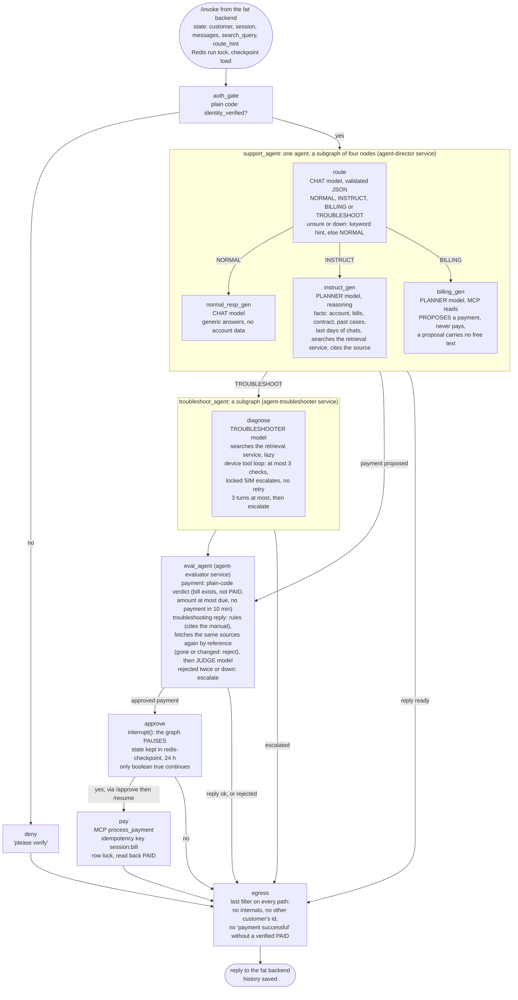

# 2. Design note

**One line:** a telecom support assistant where *money and identity are decided by deterministic code*, and language models only route, reason, word replies and judge.

The same three diagrams, rendered as one page, are in `docs/diagrams/architecture.html`. Their Mermaid sources are `docs/diagrams/*.mmd`.

## Architecture: application and system design

**Fat backend, skinny graph.** Everything slow or non-deterministic happens in the fat backend before the graph starts: verification, the guards, loading history, the query rewrite. The graph is a thin router that calls the agents through an `AgentClient` and owns the pauses and the checkpoint. The fat backend is *not* a graph node.

## The LangGraph orchestrator

The main graph has three **agent** nodes, and each is a small subgraph, so an agent is a group of nodes. Everything else is plain code.

**A payment turn.** The customer asks to pay. `support_agent` routes it BILLING, and `billing_gen` (the PLANNER model) reads the bills through MCP and *proposes* the payment; a proposal carries no free text. `eval_agent` checks it with plain code (bill exists, not paid, amount not above what is due, no payment in the last 10 minutes). The graph **pauses** at `approve`. Only an explicit yes continues to `pay`, which calls the database MCP server's `process_payment`: reserve under a row lock, call the gateway (Stripe, a stub today) with an idempotency key, settle, and read the bill back to confirm `PAID`. The egress filter allows "payment successful" text only because that confirmed read happened.

**A troubleshooting turn.** The router sends it to `troubleshoot_agent`. `diagnose` asks the retrieval service for manual sections (lazily: "thanks" needs no search; if the service is down, a human takes over). It may run up to three device checks, one at a time, chosen by the model as validated JSON from the device tools only and only for the customer's own devices. A locked SIM escalates at once. The answer cites the manual. `eval_agent` then checks the rules, fetches the same sections again from the references the troubleshooter returned (a missing or changed section rejects the reply), and asks the JUDGE model whether the reply is supported by them. The judge can only object, and only when it is confident; an outage or a timeout means no objection.

## Azure infrastructure

```mermaid
flowchart TB
  GH(["GitHub Actions<br/>OIDC: gh-support-plan (read-only), gh-support-apply"])
  CUST(["Customer"])
  TEAM(["Support team<br/>Entra group uploads manuals"])

  subgraph EXT["Outside Azure: PLACEHOLDERS, nothing configured yet"]
    EMB["Embedder API<br/>BAAI/bge-m3, provider not chosen"]
    TWL["Twilio<br/>SMS and chat channel"]
    STR["Stripe<br/>payment gateway"]
    GGL["Google Workspace<br/>Gmail support mailbox, Drive documents"]
  end

  subgraph SHARED["rg-support-shared"]
    ACR["acrsupportppiia<br/>Container Registry"]
  end
  subgraph TFS["rg-support-tfstate"]
    TFSA["stsupporttfppiia<br/>Terraform state"]
  end

  subgraph RG["rg-support-prod (region eastus2 is a placeholder)"]
    AFD["afd-support-prod: Front Door + WAF<br/>OFF until a hostname exists"]

    subgraph VNET["vnet-support-prod 10.20.0.0/16"]
      subgraph AKSN["snet-aks 10.20.0.0/22"]
        subgraph AKS["aks-support-prod: private, Standard tier, 2 x Standard_D4s_v6, workload identity"]
          subgraph NS["namespace support"]
            FB["fat-backend"]
            OR["orchestrator"]
            AD["agent-director"]
            AT["agent-troubleshooter"]
            RS["retrieval"]
            AE["agent-evaluator"]
            MCPS["mcp-servers<br/>nine servers :8001 to :8009"]
            NW["notification-worker"]
            IW["index-worker<br/>watches the docs container"]
            OT["otel-gateway, otel-sampler"]
            JOBS["CronJob indexer, CronJob prune-sessions,<br/>Job db-bootstrap"]
          end
        end
      end
      subgraph PGN["snet-postgres 10.20.8.0/24"]
        PG[("pg-support-prod-sfx<br/>Flexible Server v16, Entra-only, pgvector")]
      end
      PE["snet-private-endpoints 10.20.9.0/24<br/>pe-openai, pe-cs, pe-kv, pe-sb,<br/>pe-redis-checkpoint, pe-redis-cache, pe-redis-toolcache,<br/>pe-docs-blob, pe-uploads-blob<br/>7 private DNS zones"]
    end

    subgraph AI["Azure AI: private endpoint, Entra auth"]
      OAI["oai-support-prod-sfx: Azure OpenAI"]
      D1["chat-support<br/>gpt-5.4-mini, effort low"]
      D2["chat-planner<br/>gpt-5.4, effort medium"]
      D3["chat-rewrite<br/>gpt-5.4-nano, effort minimal"]
      D4["chat-troubleshooter<br/>gpt-5.4, effort medium"]
      D5["chat-judge<br/>gpt-5.4-mini, effort low"]
      CS["cs-support-prod-sfx<br/>Content Safety: Prompt Shields"]
      OAI --- D1 & D2 & D3 & D4 & D5
    end

    subgraph DATA["Data and storage: private endpoints, Entra auth"]
      RC[("redis-checkpoint<br/>graph state, run locks<br/>NoEviction, AOF")]
      RK[("redis-cache<br/>window, verified flag, budget<br/>LRU")]
      RT[("redis-toolcache<br/>tool results<br/>LRU")]
      B1[("stsupportdocsprod-sfx<br/>container knowledge-base")]
      B2[("stsupportuplprod-sfx<br/>container customer-uploads<br/>untrusted, scanned")]
    end

    subgraph MSG["Secrets and messaging"]
      KV["kv-support-prod-sfx<br/>Key Vault, CSI driver"]
      SB["sb-support-prod-sfx<br/>Service Bus Premium, queue notifications"]
      ACS["acs-support-prod-sfx<br/>Communication Services"]
    end

    subgraph OBS["Observability"]
      LOG["log-support-prod"]
      APPI["appi-support-prod"]
      AMW["amw-support-prod<br/>Prometheus"]
      AMG["amg-support-prod-sfx<br/>Managed Grafana"]
      AG["ag-support-prod-oncall<br/>SLO burn and resource alerts"]
    end
  end

  CUST -. "HTTPS (off)" .-> AFD -. "ingress (off)" .-> FB
  CUST -. "Twilio webhook (off)" .-> FB
  TEAM -- "upload" --> B1
  GH -- "build, sign" --> ACR
  GH -- "terraform, az aks command invoke" --> AKS
  GH -. "state" .-> TFSA
  ACR -- "image pull" --> AKS

  FB --> OR
  OR --> AD & AT & AE
  AD & AT & AE --> MCPS
  OR --> MCPS
  FB & OR & AD & AT & AE -- "Entra token" --> OAI
  FB -- "Prompt Shields" --> CS
  FB & MCPS & OR & AT & JOBS & IW -- "Entra token" --> PG
  OR --> RC
  FB --> RK
  AD & AT --> RT
  IW & JOBS --> B1
  FB --> B2
  MCPS --> SB --> NW --> ACS
  MCPS -. "SMS, email, payments, documents" .-> TWL & STR & GGL
  FB & JOBS & IW -. "embeddings" .-> EMB
  AKS -- "CSI mount" --> KV
  OT --> APPI --> LOG
  AKS -. "metrics" .-> AMW --> AMG
  AG -.-> APPI
```

There are no passwords or account keys anywhere: Postgres and Redis use Entra tokens, storage is Entra-only, and each workload has its own managed identity and its own Postgres role. Nothing has been deployed.

## Key decisions and the tradeoffs

| Decision | Why | What it costs |
|---|---|---|
| **Safety is code, not the model.** Identity, the payment verdict, approval, escalation and egress filtering are deterministic. | A model can be talked into anything. Code can be tested exhaustively. | Less flexible; every new rule is code. Models are limited to routing, wording, reasoning and a judge that can only object. |
| **An agent is a group of nodes.** `support_agent` is a subgraph (router, three generators), `troubleshoot_agent` is a subgraph, `eval_agent` checks both. The main graph has three agent nodes. | Matches the design: one agent, several specialised sub-nodes. Each agent's nodes can change without touching the main wiring. | Subgraph state is shared with the parent, so a subgraph must not re-append what the parent already holds (the audit list is tested for this). |
| **LangGraph orchestrates; Microsoft Agent Framework runs the agents; one service per agent.** | Routing and pauses in one place, agent logic isolated, each agent scaled and secured on its own (the evaluator has no write tools). | More services and network hops than one process. An `AgentClient` interface allows in-process execution when that cost matters. |
| **One model per job** (CHAT, PLANNER, REWRITE, TROUBLESHOOTER, JUDGE), each its own deployment and reasoning effort. | A greeting does not need the model that reasons about a dispute, and a 64-token rewrite does not need either. Any job's model can change alone, through Terraform. | Five deployments to size, quota and monitor. The starting models are a shortlist, not a measured result. |
| **A payment is reserve, gateway, settle, never one step.** Idempotency key, row lock, partial unique index, read-after-write. A gateway **timeout leaves the attempt `PENDING`**; `reconcile_payment` asks the gateway before any retry. | Releasing the bill on a timeout could double-charge on retry. The assumption "failed" is the dangerous one. | A customer whose payment timed out is blocked until reconciled (they are told not to pay again). |
| **Graph state and checkpoints live in Redis** (separate clusters for checkpoint, cache and tool cache), not Postgres. | Latency per graph step was the priority. Separate clusters let the checkpoint cluster use `NoEviction` + AOF while caches use LRU. | A paused payment is only as durable as Redis, and its idle TTL (24 h) bounds how long a customer can be away. A full `NoEviction` Redis refuses writes, so it has a memory alert. Losing it loses no money: the gateway is only called after approval. |
| **Tool access through one registry, over long-lived MCP connections.** The harness decides *whether* a call happens; the registry decides *where*. Writes are never auto-retried. | One place to enforce the allow-list, inject the customer id (the model never supplies it), audit, circuit-break and time out. | The MCP layer is extra machinery for a small tool set. |
| **Search and reranking are one service**, independent of MCP. The support agent and the troubleshooter search it; the eval_agent fetches the same chunks by reference. The graph keeps references, never chunk text. | One place that reads the search tables and one place to change ranking. Retrieval is a read of our own index, not a tool with side effects, and the model never chooses when to search. | One more service and network hop. If it is down, turns that need guidance go to a human. It serves company knowledge only, and the network policy is its only caller control, until it can verify callers and customers. |
| **Third-party providers sit behind MCP servers and stubs.** Twilio, Stripe, Gmail and Drive are each a server, every one defaults to a stub, and outbound text is template-only with the recipient taken from the customer's record. | A model can neither choose a recipient nor write an outbound message. The system runs and is tested before any credential exists. | Four servers to keep in the catalog. The real Gmail and Drive providers, and the Stripe customer mapping, are placeholders. |
| **The LLM judge can only object.** It checks a troubleshooting reply against its retrieved sections, objects only on a confident "unsupported", and never touches a payment. | A model can catch an invented claim that rules cannot. Failing open means it can never take a turn down. | A second model call on troubleshooting turns. A wrong confident objection escalates a good answer. |
| **Hybrid retrieval** (pgvector + keyword, rank fusion) with an optional reranker, evaluated by a recall/MRR harness. | Exact terms like error codes need keyword search; meaning needs vectors. The reranker is off until the evaluation shows it earns its latency. | Two queries per search. |
| **OpenTelemetry end to end** (W3C trace context, collector with tail sampling and PII redaction). | One customer turn is one trace across the backend, orchestrator, agent, MCP server and database; payment, escalation and error traces are always kept. | Running a collector tier. |

## Documents and uploads: two paths, deliberately kept apart

| Path | Flow | Why it is built this way |
|---|---|---|
| **Team documents** | blob `knowledge-base` -> `index-worker` (and the `indexer` CronJob as a safety net) -> pgvector | The knowledge base *mirrors* its source: an edited document replaces its old chunks and a deleted one is removed, otherwise the assistant would keep quoting corrected or withdrawn text. A listing that returns **no** documents deletes nothing, so a storage outage cannot wipe the knowledge base. The worker polls the container instead of using Event Grid, which keeps Service Bus private, and indexes only after the listing has been stable for two looks, so a multi-file upload runs once. A shared Postgres advisory lock stops the worker and the CronJob overlapping. |
| **Customer uploads** | backend -> validate -> blob `customer-uploads` (quarantine) -> Defender scan tag -> released only when "No threats found" | The file is hostile until proven otherwise. Its real bytes must match its extension, its name is reduced to a safe basename, it lives under the customer's own prefix, and a malicious file is deleted (its audit row stays). |

Decisions and costs: a customer's file is **never parsed or shown to a model**, because text inside a file can carry instructions (prompt injection). That keeps it safe but means the assistant cannot yet "read" a screenshot; it is stored for a human agent. Two storage accounts instead of one cost a little more and keep a trusted source and an untrusted drop box from ever sharing permissions.

## Edge cases handled (all tested)

- **Not verified:** nothing runs. A wrong date of birth, an unknown phone and an ambiguous name all give the *same* answer, so accounts cannot be enumerated.
- **Another customer's data:** every query is scoped by customer in SQL, no tool takes a customer id from the model, cached results are per customer, and the egress filter blocks any other customer's id in a reply.
- **Double payment:** the same key returns the original result; two concurrent payments for one bill resolve to exactly one (real row lock, tested in CI); a paid bill proposes nothing.
- **Gateway outcomes:** decline releases the bill; "service down" releases it; **timeout holds it** and the customer is told not to pay again. The Stripe gateway maps its own answers onto the same three outcomes.
- **Approval:** only an explicit boolean `true` pays. "yes", `1` and `"true"` do not.
- **Routing:** "how much data have I used" is an account question, not a fault; "my data does not work" is a fault. A router that fails or is unsure falls back to keywords, and then to the generic answer.
- **Device checks:** only device tools, only the customer's own devices, never repeated, at most three per turn. A locked SIM escalates immediately with no retry.
- **Model misbehaviour:** a reply claiming a payment that never happened is replaced; one that leaks table names, stack traces or another customer's id is replaced; manual text that tries to give instructions is dropped, and if nothing usable is left the customer is escalated. A reply the judge confidently calls unsupported is escalated, not shown.
- **Outbound messages:** SMS and email are template-only and go to the address on the customer's record, so a model can pick neither the text nor the recipient.
- **Twilio chat:** a bad or missing signature is refused; a redelivered message is answered once; the phone number does not skip verification; replies are escaped as XML.
- **Abuse:** injection attempts are blocked before any model or tool; a per-customer daily token budget caps spend; a huge message is truncated.
- **Dependencies down:** Redis outage falls back to Postgres (cache) or allows the turn (budget); an MCP server that keeps failing opens a circuit breaker; a slow query rewrite or judge falls back instead of delaying the turn; a notification provider outage retries, a bad message is dead-lettered.
- **Resumption:** a payment confirmation left open in one session is offered again in the next. The first turn of a session also gets a short note about the last five days of conversations.

## Limitations (stated plainly)

0. **Document handling is only text and Markdown.** PDFs and images from the *team* are skipped (no parsing service is wired in), and a customer's PDF or image is stored, not understood. Malware scanning relies on Defender for Storage writing its result tag, which has not been seen on a real account.
1. **Nothing has run against real Azure, Postgres, Redis or a model.** The 535 unit tests use fakes and mock HTTP. 28 integration tests will run against real Postgres and Redis only in CI, and have not run yet.
2. **Models are a starting shortlist, not a result.** The five deployments use the GPT-5.4 family because Microsoft lists GPT-4.1 as Deprecated. Availability in your region, quota (`capacity_k` is a placeholder), the deployment type, the API versions (a guess) and reasoning effort through the Agent Framework are all unverified. The final choice should come from running candidates through the journey, red-team and retrieval evaluations.
3. **Providers are placeholders.** The Stripe and Twilio clients follow the documented APIs but have never touched a real account. The Stripe customer-to-payment-method mapping is undecided, so a real charge refuses. The Gmail and Drive providers are not written. No credential exists for any of them.
4. **The payment gateway is a stub** until Stripe is switched on. The simulator proves the state machine under timeouts, declines and replays.
5. **Data gaps:** the original seed file was lost (the loader defines its own format); the device tools cover only the ones named in the brief; an Azure Managed Redis API and the alert metric names are unverified. "CRM" means the platform's own record of past support (episodes and recent chats); an external CRM would be another server behind the same tool names.
6. **The graph has no tool loop for the support agent.** Its tools run inside the agent service and the model does not choose them; only the troubleshooter has a model-driven (bounded, validated) tool loop.
7. **Single region.** Recovery targets are proposals, not signed off.
8. **Verification is knowledge-based** (phone or name plus date of birth). It is stronger than nothing and weaker than a one-time code, and the same applies on the Twilio channel.

## How it evolves as usage grows

| If this grows... | Then |
|---|---|
| **More traffic (10x)** | Scale agents and orchestrator with the existing autoscalers; tune the baseline sampling rate; cache `get_bills` less aggressively if staleness matters. The checkpoint Redis and Postgres are the first limits: size Redis with headroom, add read replicas for retrieval. Model quota per deployment is the next. |
| **Much more traffic (100x)** | Split retrieval onto its own read replica or a dedicated vector store; move to a larger zone-redundant Postgres; shard Redis; replace the in-process circuit breaker with a service mesh. |
| **More agents or capabilities** | Add an agent subgraph and a catalog entry. The harness, registry and allow-list already enforce the rules, so a new agent starts constrained. |
| **More channels** (voice, email) | The Twilio chat channel shows the pattern: a thin adapter in front of the fat backend, which still owns identity and memory. Verification should move to one-time codes. |
| **Higher-risk actions** (refunds, plan changes) | Reuse the propose, evaluate, approve, execute pattern. Each action gets its own deterministic evaluator and idempotency key. |
| **Multi-region** | Warm standby for Postgres (geo-replica) and a second AKS cluster behind Front Door. This needs its own budget and a decision on the checkpoint Redis (replicate or accept loss of paused payments on failover). |
| **Stronger assurance** | An independent judge from a different model family in CI (a harness exists), red-team tests grown from real attempts, and a real payment gateway with reconciliation jobs. |
