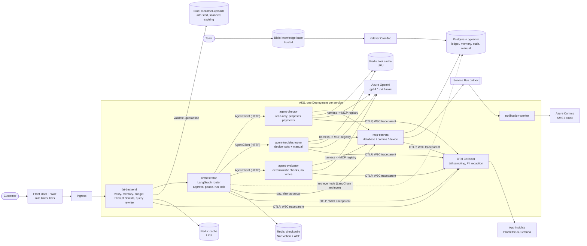

# 2. Design note

**One line:** a telecom support assistant where *money and identity are decided by deterministic code*, and language models only help with wording and tool choice.

## Architecture

**A payment turn:** the customer asks to pay. The Director *proposes* an action (it carries no free text). The Evaluator checks it with plain code (bill exists, not paid, amount not above what's due, no payment in the last 10 minutes). The graph **pauses** for an explicit approval. Only then does the database MCP server run `process_payment`: reserve under a row lock, call the gateway with an idempotency key, settle, and read the bill back to confirm `PAID`. A final filter allows "payment successful" text only because that confirmed read happened.

## Key decisions and the tradeoffs

| Decision | Why | What it costs |
|---|---|---|
| **Safety is code, not the model.** Identity, payment checks, approval, escalation and egress filtering are deterministic. | A model can be talked into anything. Code can be tested exhaustively. | Less flexible; every new rule is code. The model is limited to wording and (optionally) read-only tool choice. |
| **LangGraph orchestrates; Microsoft Agent Framework runs the agents; one service per agent.** | Clear separation: routing and pauses in one place, agent logic isolated, each agent scaled and secured on its own (the evaluator has no write tools). | More services and network hops than one process. An `AgentClient` interface allows in-process execution when that cost matters. |
| **A payment is reserve, gateway, settle, never one step.** Idempotency key, row lock, partial unique index, read-after-write. A gateway **timeout leaves the attempt `PENDING`**; `reconcile_payment` asks the gateway before any retry. | Releasing the bill on a timeout could double-charge on retry. The assumption "failed" is the dangerous one. | A customer whose payment timed out is blocked until reconciled (they are told not to pay again). |
| **Graph state and checkpoints live in Redis** (separate clusters for checkpoint, cache and tool cache), not Postgres. | Latency per graph step was the priority. Separate clusters let the checkpoint cluster use `NoEviction` + AOF while caches use LRU. | A paused payment is only as durable as Redis, and its idle TTL (24 h) bounds how long a customer can be away. A full `NoEviction` Redis refuses writes, so it has a memory alert. Losing it loses no money: the gateway is only called after approval. |
| **Tool access through one registry, over long-lived MCP connections.** The harness decides *whether* a call happens; the registry decides *where*. Writes are never auto-retried. | One place to enforce the allow-list, inject the customer id (the model never supplies it), audit, circuit-break and time out. | The MCP layer is extra machinery for a small tool set. |
| **Hybrid retrieval** (pgvector + keyword, rank fusion) with an optional reranker, evaluated by a recall/MRR harness. | Exact terms like error codes need keyword search; meaning needs vectors. The reranker is off until the evaluation shows it earns its latency. | Two queries per search. |
| **Two model tiers** (`gpt-4.1` for hard turns, `gpt-4.1-mini` for easy ones), routed by a deterministic rule with fallback. | Cost and latency. | The routing rule is a heuristic that needs tuning on real conversations. |
| **OpenTelemetry end to end** (W3C trace context, collector with tail sampling and PII redaction). | One customer turn is one trace across the backend, orchestrator, agent, MCP server and database; payment, escalation and error traces are always kept. | Running a collector tier. |

## Documents and uploads: two paths, deliberately kept apart

| Path | Flow | Why it is built this way |
|---|---|---|
| **Team documents** | blob `knowledge-base` -> indexer -> pgvector | The knowledge base *mirrors* its source: an edited document replaces its old chunks and a deleted one is removed, otherwise the assistant would keep quoting corrected or withdrawn text. A listing that returns **no** documents deletes nothing, so a storage outage cannot wipe the knowledge base. |
| **Customer uploads** | backend -> validate -> blob `customer-uploads` (quarantine) -> Defender scan tag -> released only when "No threats found" | The file is hostile until proven otherwise. Its real bytes must match its extension, its name is reduced to a safe basename, it lives under the customer's own prefix, and a malicious file is deleted (its audit row stays). |

Decisions and costs: a customer's file is **never parsed or shown to a model**, because text inside a file can carry instructions (prompt injection). That keeps it safe but means the assistant cannot yet "read" a screenshot; it is stored for a human agent. Two storage accounts instead of one cost a little more and keep a trusted source and an untrusted drop box from ever sharing permissions.

## Edge cases handled (all tested)

- **Not verified:** nothing runs. A wrong date of birth, an unknown phone and an ambiguous name all give the *same* answer, so accounts cannot be enumerated.
- **Another customer's data:** every query is scoped by customer in SQL, no tool takes a customer id from the model, cached results are per customer, and the egress filter blocks any other customer's id in a reply.
- **Double payment:** the same key returns the original result; two concurrent payments for one bill resolve to exactly one (real row lock, tested in CI); a paid bill proposes nothing.
- **Gateway outcomes:** decline releases the bill; "service down" releases it; **timeout holds it** and the customer is told not to pay again.
- **Approval:** only an explicit boolean `true` pays. "yes", `1` and `"true"` do not.
- **Model misbehaviour:** a reply claiming a payment that never happened is replaced; one that leaks table names, stack traces or another customer's id is replaced; text from the manual that tries to give instructions is dropped, and if nothing usable is left the customer is escalated.
- **Abuse:** injection attempts are blocked before any model or tool; a per-customer daily token budget caps spend; a huge message is truncated.
- **Dependencies down:** Redis outage falls back to Postgres (cache) or allows the turn (budget); an MCP server that keeps failing opens a circuit breaker; a notification provider outage retries, a bad message is dead-lettered.
- **Resumption:** a payment confirmation left open in one session is offered again in the next.

## Limitations (stated plainly)

0. **Document handling is only text and Markdown.** PDFs and images from the *team* are skipped (no parsing service is wired in), and a customer's PDF or image is stored, not understood. Malware scanning relies on Defender for Storage writing its result tag, which has not been seen on a real account.
1. **Nothing has run against real Azure, Postgres, Redis or a model.** The 389 unit tests use fakes. 28 integration tests will run against real Postgres and Redis only in CI, and have not run yet.
2. **The payment gateway is a stub.** The simulator proves the state machine under timeouts, declines and replays, but no real gateway is integrated.
3. **The Agent Framework is checked against its API only**, not against a live model. Model-driven tool calling in the Director is off by default (`DIRECTOR_TOOL_CALLING`) until it has been run end to end.
4. **Intent classification falls back to keywords**, and the model-tier routing is a heuristic.
5. **Data gaps:** the original seed file was lost (the loader defines its own format); the device tools cover only the ones named in the brief; an Azure Managed Redis API and the alert metric names are unverified.
6. **Single region.** Recovery targets are proposals, not signed off.
7. **Verification is knowledge-based** (phone or name plus date of birth). It is stronger than nothing and weaker than a one-time code.

## How it evolves as usage grows

| If this grows... | Then |
|---|---|
| **More traffic (10x)** | Scale agents and orchestrator with the existing autoscalers; tune the baseline sampling rate; cache `get_bills` less aggressively if staleness matters. The checkpoint Redis and Postgres are the first limits: size Redis with headroom, add read replicas for retrieval. |
| **Much more traffic (100x)** | Split retrieval onto its own read replica or a dedicated vector store; move to a larger zone-redundant Postgres; shard Redis; replace the in-process circuit breaker with a service mesh. |
| **More agents or capabilities** | Add an agent service and a catalog entry. The harness, registry and allow-list already enforce the rules, so a new agent starts constrained. |
| **More channels** (voice, WhatsApp) | The backend already owns identity and memory; add channel adapters in front of it. Verification would need to move to one-time codes. |
| **Higher-risk actions** (refunds, plan changes) | Reuse the propose, evaluate, approve, execute pattern. Each action gets its own deterministic evaluator and idempotency key. |
| **Multi-region** | Warm standby for Postgres (geo-replica) and a second AKS cluster behind Front Door. This needs its own budget and a decision on the checkpoint Redis (replicate or accept loss of paused payments on failover). |
| **Stronger assurance** | An independent model-based judge in CI (a harness exists), red-team tests grown from real attempts, and a real payment gateway with reconciliation jobs. |
